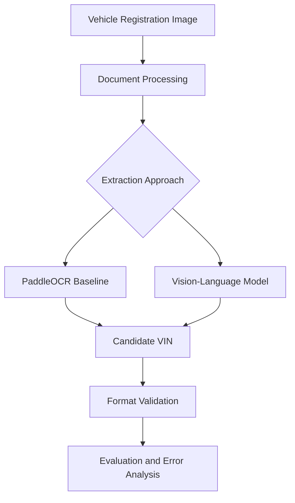

# VisionVIN
### Intelligent Vehicle Identification Through Computer Vision

**OCR · Vision-Language Models · Document Intelligence · Python**

*A computer vision research and engineering project developed during my Summer 2026 Data Science Internship at A.W. Rostamani, Dubai, UAE.*

---

## Overview

VisionVIN explores automated Vehicle Identification Number (VIN) extraction from vehicle registration documents using Optical Character Recognition (OCR) and modern vision-language models.

A VIN is a standardized 17-character vehicle identifier. Extracting VINs from real-world documents presents challenges involving image quality, document layouts, visual noise, and the similarity between certain alphanumeric characters.

This project investigates how traditional OCR techniques perform on vehicle documentation and explores more advanced multimodal approaches to document understanding.

**Research objective:** Develop and evaluate approaches for improving the reliability of automated VIN extraction while identifying the limitations of conventional OCR systems.

## Project at a Glance

| Metric | Initial Evaluation |
|:---|---:|
| Registration document images | **147** |
| Correct baseline VIN extractions | **22** |
| Baseline exact-match accuracy | **14.97%** |
| Expected VIN length | **17 characters** |
| Initial OCR approach | PaddleOCR |
| Explored vision-language model | Qwen2.5-VL-3B |

> **Evaluation note:** The 14.97% figure represents the initial PaddleOCR baseline, not the final accuracy of the project or the performance of Qwen2.5-VL-3B.

---

## The Engineering Challenge

Traditional OCR systems are designed to identify text within images. However, extracting a precise identifier from a complex registration document introduces several additional problems.

**Document variability:** Differences in document format, text placement, resolution, and background noise can affect detection.

**Character-level accuracy:** VINs contain characters that can be visually confused, making even a single incorrect character significant.

**Structured extraction:** Recognizing arbitrary text is different from locating and extracting one specific 17-character identifier.

**Validation:** Model outputs must be checked against VIN formatting requirements rather than accepted as valid simply because text was detected.

These challenges motivated an investigation of both conventional OCR and vision-language model approaches.

## Technical Architecture

The following diagram illustrates a conceptual VIN extraction and validation workflow explored through the project.



*This is a simplified conceptual architecture, not a claim about a deployed production system.*

## 01 — Establishing an OCR Baseline

The initial investigation evaluated PaddleOCR on 147 vehicle registration document images.

The objective was to determine how reliably a conventional OCR system could recover the expected VIN.

### Initial results

| Outcome | Documents | Share |
|---|---:|---:|
| Correct VIN extraction | 22 | 14.97% |
| Not correctly extracted | 125 | 85.03% |
| Total evaluated | 147 | 100% |

**Key finding:** The initial PaddleOCR approach correctly extracted the expected VIN in 22 of the 147 evaluated images.

This result established a baseline and demonstrated the difficulty of obtaining reliable VIN extraction through the initial OCR approach.

It also highlighted the importance of moving beyond generic text recognition toward document-specific extraction and validation.

## 02 — Understanding Extraction Failures

A central part of the investigation involved exploring why text recognition approaches can struggle with vehicle registration documents.

Important areas of analysis included:

- Character confusion between visually similar letters and digits
- Document layout complexity
- Variations in image quality and text visibility
- Incorrect identification of the relevant text region
- Partial or malformed VIN extraction

These categories describe relevant technical challenges; measured counts for individual failure categories are not yet documented here.

### Why exact matching matters

Unlike ordinary text transcription, VIN extraction is a high-precision identification problem.

For example, consider the following fictional VIN-format sample:

```text
Expected: 1HGCM82633A004352
Extracted: 1HGCM82633A00435Z
```

A single incorrect character makes the extraction an exact-match failure.

This distinction matters when evaluating document AI systems: high character recognition accuracy does not necessarily imply reliable full-identifier extraction.

## 03 — Exploring Vision-Language Models

Following the initial OCR evaluation, the project explored Qwen2.5-VL-3B as an alternative approach.

Vision-language models can interpret visual inputs in conjunction with textual instructions, creating opportunities for more targeted document understanding.

Rather than relying exclusively on general-purpose OCR output, this approach investigates whether a multimodal model can better identify and interpret relevant document content.

### Approaches investigated

| Approach | Role in the investigation |
|---|---|
| PaddleOCR | Initial OCR baseline |
| Qwen2.5-VL-3B | Alternative multimodal extraction approach |
| VIN format checks | Validation of candidate identifiers |
| Error analysis | Understanding extraction limitations |

**Important:** A directly comparable accuracy benchmark for Qwen2.5-VL-3B has not been included because verified results are not yet provided.

## 04 — VIN Validation

Vehicle Identification Numbers normally follow a 17-character format with restricted alphabetic characters.

Basic structural validation can enforce:

- Exactly 17 characters
- Uppercase alphanumeric representation
- Exclusion of the letters I, O, and Q

Conceptual validation rule:

```python
import re

VIN_PATTERN = re.compile(r"^[A-HJ-NPR-Z0-9]{17}$")

def is_valid_vin_format(vin: str) -> bool:
    return bool(VIN_PATTERN.fullmatch(vin))
```

This checks basic VIN formatting. It does not implement complete VIN verification, manufacturer rules, or check-digit validation.

*The example above is illustrative and should not be interpreted as proprietary internship source code.*

## 05 — Experimental Results and Findings

### Baseline evaluation

The initial PaddleOCR experiment achieved:

**22 / 147 = 14.97% exact-match accuracy**

This measurement provided a useful starting point for understanding the document extraction challenge.

### Engineering insights

**1. Domain constraints matter.** A generic text-recognition output is not necessarily a valid structured identifier.

**2. Small recognition errors can have large consequences.** Exact-match evaluation is particularly important for fixed-format identifiers.

**3. Error analysis should inform model selection.** Understanding failure conditions provides a more useful foundation for improvement than changing models without investigating the baseline.

**4. Multimodal approaches merit investigation.** Vision-language models provide an alternative strategy for extracting specific information from complex visual documents.

These findings describe the technical investigation, not a claim that a particular model achieved a verified improvement.

## 06 — Technology Stack

| Category | Technologies |
|---|---|
| Programming | Python |
| OCR | PaddleOCR |
| Vision-language modeling | Qwen2.5-VL-3B |
| Data processing | Document image processing |
| Evaluation | Exact-match comparison and error analysis |
| Validation | VIN format constraints |

## 07 — Repository Structure

Suggested public repository organization:

```text
vision-vin/
├── README.md
├── assets/
│   ├── architecture.svg
│   ├── baseline-results.svg
│   └── synthetic-demo.png
├── docs/
│   ├── methodology.md
│   ├── evaluation.md
│   └── lessons-learned.md
├── examples/
│   └── synthetic-vin-example.py
├── LICENSE
└── .gitignore
```

Only link to or document executable files once they have actually been added and tested.

## 08 — Future Directions

Potential extensions to this investigation include:

- Building a consistent OCR versus VLM evaluation harness
- Improving document region detection
- Testing preprocessing strategies
- Adding complete VIN check-digit validation where applicable
- Measuring extraction latency and inference cost
- Evaluating model robustness under controlled image degradation
- Developing a small demonstration interface using synthetic documents

These are proposed extensions, not completed results.

## 09 — Lessons Learned

This internship provided hands-on exposure to the challenges of applying machine learning to real-world document processing.

The work reinforced the importance of establishing a measurable baseline, understanding how models fail, incorporating domain-specific constraints, and investigating alternative approaches when initial results reveal limitations.

It also emphasized that engineering progress involves more than training or selecting a model: careful evaluation, reproducibility, and analysis are essential.

## Confidentiality and Data Usage

This repository is intended as a public technical case study and educational demonstration.

It does not include confidential A.W. Rostamani source code, private datasets, real customer registration documents, or proprietary internal materials.

Illustrative document examples should use synthetic data. Public demonstrations and implementations should be independently created or shared only with appropriate authorization.

The project description reflects internship experience and does not imply endorsement by A.W. Rostamani.

---

## Author

**Raghavendra Sharma**

Computer Engineering · Virginia Tech

Minors in Computer Science, Mathematics, and Quantum Information Science & Engineering

Interests: Embedded Systems · FPGA · Computer Vision · Robotics · AI

**Project context:** Summer 2026 Data Science Internship at A.W. Rostamani, Dubai.

---

*Exploring intelligent systems at the intersection of software, visual perception, and real-world engineering.*